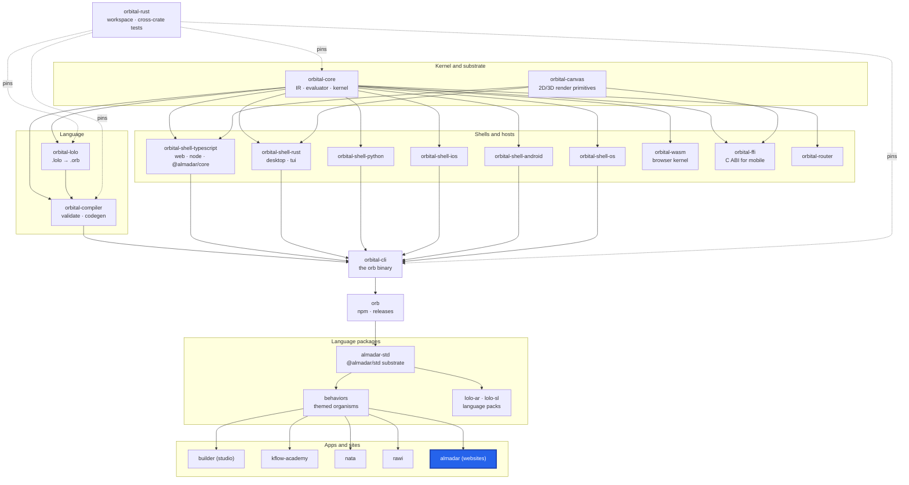

<div align="center">

# Almadar

**The almadar.io website and the repo that also hosts the orb.almadar.io site, tests, templates and skills.**

[](https://github.com/almadar-io/almadar/actions/workflows/ci.yml)
[](LICENSE)

</div>

Almadar builds tools for software whose behavior is a verified, first-class artifact: natural language becomes a `.lolo` program, which lowers to `.orb` IR and runs as a full-stack app. This repo is the public home of that work: the almadar.io site (`website/`, built from the `std-almadar-website` organism), the orb.almadar.io site (the `orb/` submodule), and the black-box language tests, shell templates and agent skills.

## Where this fits



| Upstream (this repo depends on) | Downstream (depends on this repo) |
|---|---|
| [behaviors](https://github.com/almadar-io/behaviors): the `std-almadar-website` organism the site is built from | none inside the monorepo |
| [almadar-std](https://github.com/almadar-io/almadar-std): `@almadar/std`, the substrate | |
| [orb](https://github.com/almadar-io/orb): the `orb/` submodule (the orb site, `@almadar/orb`) and its shared `build-site.mjs` | |

## Quick start

```bash
cd website
pnpm install --ignore-workspace
pnpm build          # orb compile --mode client, then prerender every route into website/build/
```

There is no site source in `website/`: `pnpm build` compiles the installed `std-almadar-website` organism with `orb`, prerenders every route and copies `static/` beside the result, using the script shared with orb.almadar.io (`orb/scripts/build-site.mjs`). Deploy with `pnpm deploy` (Firebase Hosting target `main`, project `kflow-b3a39`); CI deploys on a `v*` tag.

## What's inside

| Path | What |
|---|---|
| `website/` | almadar.io: `package.json`, `static/`, `firebase.json`; the page content is the organism |
| `orb/` | submodule [almadar-io/orb](https://github.com/almadar-io/orb): orb.almadar.io and the `orb` npm/releases distribution |
| `tests/` | black-box `.orb` schemas for language features (`tests/schemas/`) and `tests/run-tests.sh` |
| `examples/` | example programs |
| `templates/` | shell templates (`python-shell/`) |
| `skills/` | agent skills (`almadar-orb-universal`, `almadar-orbitals`) |

Community: [Discord](https://discord.gg/q83VjPJx) and [GitHub Discussions](https://github.com/almadar-io/almadar/discussions). Contribution guidance is in [CONTRIBUTING.md](CONTRIBUTING.md). Built by [Almadar](https://almadar.io) in Ljubljana, Slovenia.

## Development

The `ci.yml` workflow runs on push to `main` and checks that every `.orb` file in `tests/schemas/` and `examples/` is valid JSON. The package scripts are `validate`, `compile`, `dev` and `test`, each a call to the `almadar` CLI from `@almadar/cli`.

```bash
pnpm install --frozen-lockfile
pnpm test
pnpm exec eslint --no-warn-ignored --max-warnings 0 <files you touched>
```

Open gaps are in `Almadar_Gaps.md`. Work on `main` only; never publish from here (releases go through the monorepo cascade and CI).

## Docs
- [Orb language docs](https://orb.almadar.io/docs/getting-started/introduction)

## License
Business Source License 1.1, Licensor Almadar FZE; production use for non-commercial purposes and internal evaluation is granted, and the license converts to Apache 2.0 on 2030-02-01. See [LICENSE](LICENSE).
